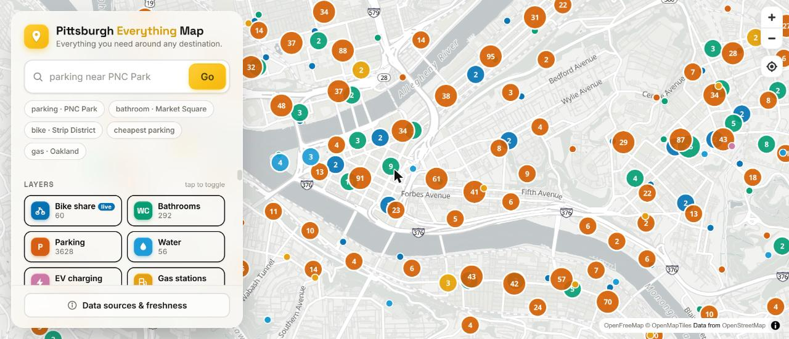
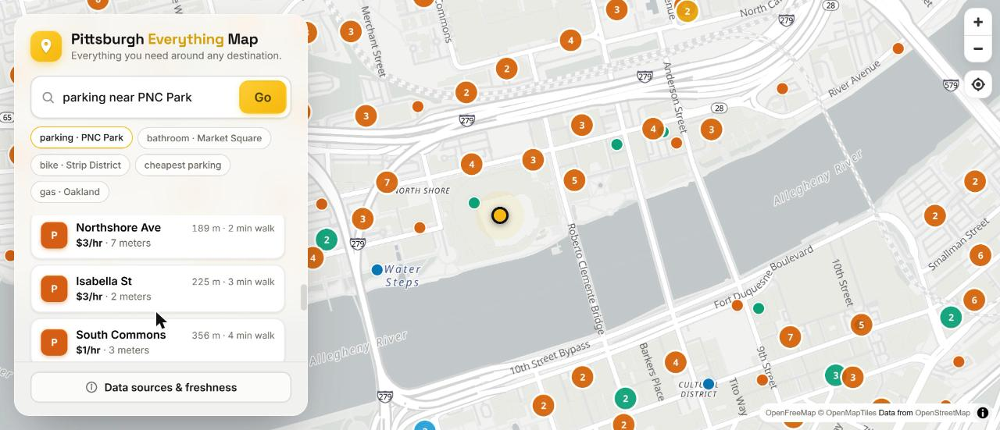

# Pittsburgh Everything Map

One map of Pittsburgh with **everything you need around a destination** — not just how to get there. Type a place or a need ("parking near PNC Park", "bathroom near Market Square", "cheapest parking downtown") and see the closest parking, public bathrooms, live bike-share docks, water fountains and EV chargers, with walking distance and price where it's known.

> Google Maps gets you somewhere. It doesn't tell you where to park, what it costs, where the nearest public bathroom is, or whether there's a bike to grab. This does.

**Live demo:** _(added after deploy)_





---

## What it does

- **Full-screen map** of Pittsburgh (MapLibre GL + free, keyless OpenFreeMap/OpenStreetMap tiles).
- **Clustered markers**: nearby points merge into numbered clusters that split as you zoom in, so dense layers (3,600+ parking spots) stay readable instead of blanketing the city.
- **Six toggleable layers**, each a distinct colour-blind-safe colour **and icon**, with a legend and live counts:
  - 🔵 **Bike share** — POGOH stations with **live** bikes & docks available.
  - 🟢 **Public bathrooms** — OpenStreetMap toilets + community-submitted Refuge Restrooms.
  - 🟠 **Parking** — garages & lots (OpenStreetMap) + on-street meters with zones & rates (WPRDC).
  - 🔵 **Water fountains** — OpenStreetMap drinking-water points.
  - 🟣 **EV charging** — OpenStreetMap charging stations.
  - 🟡 **Gas stations** — OpenStreetMap fuel stations (brand where known; no live prices).
- **Smart search** with no AI and no paid API: a built-in list of Pittsburgh landmarks, a rule-based understanding of requests ("parking", "bathroom", "near X", "cheapest"), and a free Nominatim fallback for anything else.
- **Results panel** listing the nearest options per layer with walking distance. On-street meters are **grouped by block** ("W General Robinson St · 12 meters · $3/hr"), garages & lots get their own section, and near PNC Park / Acrisure Stadium / PPG Paints Arena a note flags that **event-day rates may differ**. Prices appear only where there's a source (`price unknown` otherwise).
- **Click any marker** for details and its data source.
- **Phone-friendly & accessible**: real buttons, keyboard support, a bottom sheet on small screens, readable contrast.
- **A "Data sources" panel** showing where every layer comes from and when each snapshot was last refreshed. Live data is clearly labelled "live"; nothing else is claimed to be live.

## Where the data comes from

| Layer | Source | Key needed? | Freshness |
|---|---|---|---|
| Bike share | [POGOH GBFS](https://pittsburgh.publicbikesystem.net/customer/gbfs/v2/gbfs.json) | No | **Live** (fetched per visit) |
| Bathrooms | [OpenStreetMap](https://overpass-api.de/) + [Refuge Restrooms](https://www.refugerestrooms.org/) | No | Weekly snapshot |
| Parking | [OpenStreetMap](https://overpass-api.de/) + [WPRDC meters](https://data.wprdc.org/dataset/parking-meters-and-payment-points) | No | Weekly snapshot — **meter rates are as of 2019** |
| Water fountains | [OpenStreetMap](https://overpass-api.de/) | No | Weekly snapshot |
| EV charging | [OpenStreetMap](https://overpass-api.de/) | No | Weekly snapshot |
| Gas stations | [OpenStreetMap](https://overpass-api.de/) | No | Weekly snapshot (no live prices) |
| Base map | [OpenFreeMap Positron](https://openfreemap.org/) (OSM data) | No | — |
| Place search | [Nominatim](https://nominatim.openstreetmap.org/) | No | Live, ≤1 req/sec |

Everything is **free and needs no API key or credit card.** All attribution is shown on the map and in the in-app Data Sources dialog.

## How it's built

```
pittsburgh-map/
├─ index.html            # the page shell
├─ src/
│  ├─ main.js            # wires everything together
│  ├─ map.js             # MapLibre setup, layers, popups
│  ├─ search.js          # landmark match + Nominatim fallback
│  ├─ intent.js          # rule-based "what does this search mean"
│  ├─ results.js         # the nearest-options list
│  ├─ geo.js             # distance + walking-time maths
│  ├─ config.js          # one place that defines every layer
│  ├─ landmarks.js       # built-in Pittsburgh places
│  ├─ sources.js         # source descriptions for the dialog
│  └─ style.css          # all styles (light theme, mobile bottom sheet)
├─ lib/bikes.mjs         # POGOH fetch logic (shared by API + dev server)
├─ api/bikes.js          # Vercel serverless proxy for live bikes
├─ scripts/fetch-data.mjs# grabs slow data -> public/data/*.geojson
├─ public/data/          # generated GeoJSON snapshots + meta.json
└─ .github/workflows/refresh-data.yml  # weekly auto-refresh
```

**Two kinds of data, handled differently:**

- **Slow-changing data** (bathrooms, parking, fountains, EV) is fetched **once** by `scripts/fetch-data.mjs` into static GeoJSON files in `public/data/`. The map loads these instantly and we don't hammer the free APIs on every visit. A GitHub Action re-runs the script **weekly** and commits any changes.
- **Live data** (POGOH bikes) is fetched **in the browser** on each visit. POGOH's feed doesn't allow direct browser calls (CORS), so a tiny **Vercel serverless function** at `/api/bikes` proxies it. The same endpoint is emulated in the Vite dev server, so local and production behave identically.

Data loading is **decoupled from the base map**: the layer data and search work even if the map tiles are slow to load, and markers are drawn as soon as the map style is ready. A couple of free sources (Overpass especially) return 502s under load, so the fetch script **rotates across mirrors and retries**.

## Run it locally

You need [Node.js](https://nodejs.org/) 18+.

```bash
npm install
npm run fetch-data   # grab fresh snapshot data into public/data/ (optional; data is committed)
npm run dev          # start the dev server, then open the printed http://localhost URL
```

Build a production bundle with `npm run build` (output in `dist/`).

## Deploy

This repo is set up for **Vercel** (zero config — `vercel.json` sets the Vite build and the `api/` folder becomes serverless functions automatically):

1. Push to GitHub.
2. On [vercel.com](https://vercel.com), **Add New → Project → Import** this repo.
3. Click **Deploy**. Vercel detects Vite, builds it, and hosts `/api/bikes` as a function.

## What I'd add next (v2)

- **Transit**: Pittsburgh Regional Transit stops and live arrivals (GTFS / GTFS-Realtime).
- **"Plan my trip" briefing**: pick a destination and time and get the best parking, nearest bathroom and nearest bike dock in a single card.
- **An MCP server** so I can ask Claude Desktop questions about the map ("cheapest parking near the stadium on a game night").
- Richer parking rates once a newer rate dataset is available (current meter rates, not 2019).
- Offline-friendly caching and a "near me" default using the browser's location.

## Credits & licences

Map data © OpenStreetMap contributors (ODbL). Base tiles © OpenFreeMap. Bike data © POGOH (GBFS). Parking data © Western Pennsylvania Regional Data Center. Bathroom data also from Refuge Restrooms. Built with [MapLibre GL JS](https://maplibre.org/) and [Vite](https://vitejs.dev/).
